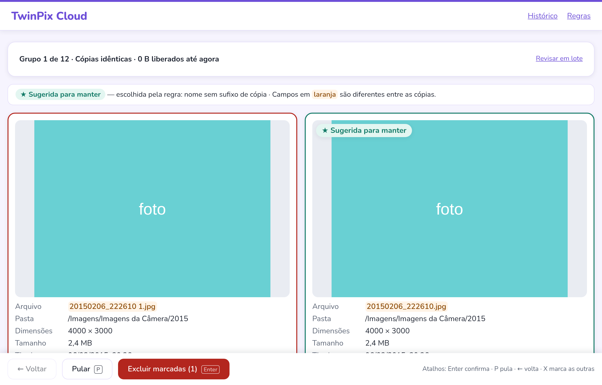
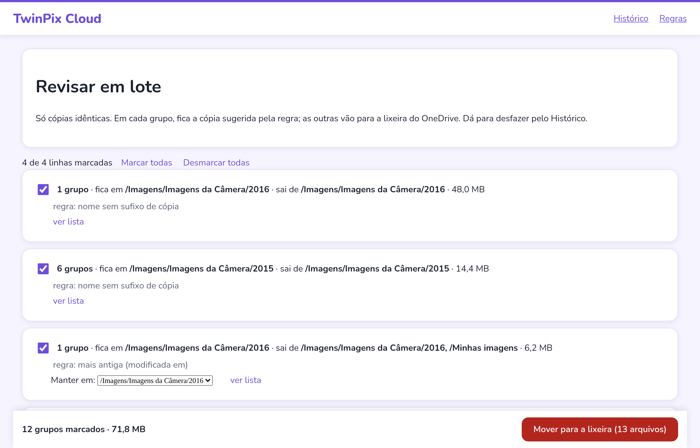

<h1 align="center">TwinPix Cloud</h1>

  <a href="#computer-projeto">Projeto</a>&nbsp;&nbsp;&nbsp;|&nbsp;&nbsp;&nbsp;
  <a href="#bulb-como-funciona">Como funciona</a>&nbsp;&nbsp;&nbsp;|&nbsp;&nbsp;&nbsp;
  <a href="#sparkles-funcionalidades">Funcionalidades</a>&nbsp;&nbsp;&nbsp;|&nbsp;&nbsp;&nbsp;
  <a href="#eyes-como-usar">Como usar</a>&nbsp;&nbsp;&nbsp;|&nbsp;&nbsp;&nbsp;
  <a href="#rocket-tecnologias">Tecnologias</a>&nbsp;&nbsp;&nbsp;|&nbsp;&nbsp;&nbsp;
  <a href="#memo-licença">Licença</a>

  
  
  

  

## :computer: Projeto

O **TwinPix Cloud** encontra fotos e vídeos repetidos no **OneDrive** e ajuda a limpar o que
sobra, sem medo de perder nada.

Nasceu de um problema real: anos de backup do celular, pastas copiadas de um computador para
outro e "Minhas imagens" duplicadas deixaram milhares de cópias espalhadas. Apagar à mão é
lento e arriscado; os apps prontos apagam rápido demais. Aqui você vê as cópias lado a lado,
decide, e tudo vai para a lixeira, com desfazer.

O app roda **no seu próprio computador** e conversa direto com o seu OneDrive. Nenhum servidor
de terceiros vê os seus arquivos.

## :bulb: Como funciona

- **Só lê as informações dos arquivos.** Nome, pasta, tamanho, data em que a foto foi tirada,
  dimensões e uma "impressão digital" do conteúdo que o próprio OneDrive já calcula. Nenhuma
  foto é baixada.
- **Compara o conteúdo, não o nome.** Duas fotos com nomes diferentes mas o mesmo conteúdo são
  cópias idênticas. Duas fotos com o mesmo nome mas conteúdo diferente **não** são.
- **Nada é apagado de vez.** Tudo o que você escolher vai para a **lixeira do OneDrive**, e o
  próprio app desfaz (uma cópia, um grupo ou um lote inteiro).
- **Sempre sobra uma cópia.** O app não deixa excluir todas as cópias de um grupo, nem por
  engano.
- **Confere de novo antes de mover.** Se um arquivo mudou no OneDrive depois da análise, o app
  não mexe nele e pede para você olhar de novo.
- **Sugere qual manter, você decide.** Uma estrela ★ mostra a cópia sugerida (por exemplo, a que
  não tem " 1" no nome, ou a que está na pasta mais organizada). As regras são suas: dá para
  mudar a ordem na tela **Regras**.

## :sparkles: Funcionalidades

**Três tipos de repetição**

- **Cópias idênticas**: mesmo conteúdo, byte a byte. O caso mais seguro.
- **Prováveis cópias**: não são idênticas, mas parecem a mesma foto ou vídeo (mesmo nome-base,
  mesmas dimensões, mesma data em que foi tirada). Podem ser a original e uma versão editada,
  por isso nunca vêm marcadas.
- **Pastas repetidas**: quando uma pasta inteira foi copiada para outro lugar, o app junta tudo
  em um conjunto e mostra qual pasta manter.

**Um por um ou em lote: qual usar?**

| | Revisão um por um | Lote |
|---|---|---|
| **Como é** | Um grupo por vez, as cópias lado a lado, com miniatura e detalhes | Uma lista resumida por par de pastas ("fica em X · sai de Y · 6 grupos · 14 MB") |
| **Quando usar** | Quando você quer olhar cada caso, ou quando são prováveis cópias | Quando há centenas de cópias idênticas e o padrão é sempre o mesmo |
| **O que dá para fazer** | Marcar, pular, voltar, excluir as marcadas | Marcar e desmarcar linhas, **ver lista** de cada linha, **trocar a pasta que fica** (inverter), mover tudo de uma vez |
| **Desfazer** | Cada grupo, pelo Histórico | O lote inteiro com um clique, pelo Histórico ou no fim do lote |

O lote só aceita o que é seguro em massa: cópias idênticas e, num lote separado, as
**prováveis regravações** (a mesma foto salva de novo, com o arquivo só um pouquinho diferente).
Essas vêm **desmarcadas** e com miniaturas, para você conferir antes de marcar.

  

**Atalhos de teclado na revisão um por um**

| Tecla | O que faz |
|---|---|
| `Enter` | Abre a confirmação (e confirma) |
| `X` | Marca todas as cópias menos a sugerida e abre a confirmação |
| `P` | Pula o grupo |
| `←` | Volta para o grupo anterior |

**E mais:** escolher várias pastas de uma vez ou colar o endereço de uma pasta do OneDrive, pausar,
continuar ou cancelar a análise, retomar se a internet cair, histórico de tudo o que foi feito.

## :eyes: Como usar

Você precisa do [Node.js](https://nodejs.org/) 22 ou mais novo. Baixe o projeto (botão
**Code → Download ZIP**, ou `git clone`), abra um terminal na pasta e siga um dos caminhos.

### 1. Experimentar sem conectar (modo demonstração)

    npm install
    npm run demo

O navegador abre com arquivos fictícios. Nada acontece no seu OneDrive. É o melhor jeito de
ver como tudo funciona antes de usar de verdade.

### 2. Registrar o app na Microsoft (uma vez só)

Para o app poder conversar com o seu OneDrive, a Microsoft pede que ele seja registrado na sua
conta. É gratuito e leva uns 10 minutos.

1. Acesse [entra.microsoft.com](https://entra.microsoft.com) com a sua conta Microsoft.
   - **Conta pessoal (Outlook, Hotmail):** se aparecer o erro *"A conta de usuário selecionada
     não existe no locatário 'Microsoft Services'"*, crie antes uma **conta gratuita do Azure**
     em [signup.azure.com](https://signup.azure.com). Ela cria um **"Diretório padrão"** para
     você. O cartão é pedido só para confirmar a identidade; nada é cobrado. Se o portal
     continuar com o erro, tente numa janela anônima do navegador.
2. Vá em **Registros de aplicativo → Novo registro** e preencha:
   - **Nome:** `TwinPix Cloud` (ou o que quiser);
   - **Tipos de conta:** *Somente contas pessoais da Microsoft*;
   - **URI de redirecionamento:** plataforma *Cliente público/nativo (móvel e área de
     trabalho)*, endereço `http://localhost:4317/api/auth/callback`.
3. Em **Permissões de API → Adicionar permissão → Microsoft Graph → Permissões delegadas**,
   marque `Files.ReadWrite` e `offline_access`.
4. Na página do registro, copie o **ID do aplicativo (cliente)**.
5. Na pasta do projeto, copie o arquivo `.env.example` para `.env` e cole o ID depois de
   `TWINPIX_CLIENT_ID=`.

### 3. Conectar e analisar

    npm install
    npm run build
    npm start

1. O navegador abre sozinho. Clique em **Conectar ao OneDrive** e entre na sua conta Microsoft.
2. Escolha as pastas para analisar (pode marcar várias) ou **cole o endereço** de uma pasta do
   OneDrive e clique em **Adicionar**.
3. Clique em **Iniciar análise**. Em pastas grandes leva alguns minutos; dá para pausar e continuar.
4. No fim, escolha **revisar um por um**, **revisar em lote**, **prováveis cópias** ou
   **pastas repetidas**.
5. Arrependeu? Abra o **Histórico** e desfaça.

## :rocket: Tecnologias

       

Para quem quer mexer no código

    npm run dev        # API em 127.0.0.1:4317 e interface em http://localhost:5173
    npm test           # testes da API e da interface
    npm run typecheck

Em modo dev, abra `http://localhost:5173/#token=dev-local`.

- O app fala com a nuvem só pela interface `CloudProvider`
  (`apps/api/src/cloud/cloud-provider.ts`). Para outra nuvem, implemente essa interface (veja
  `onedrive/onedrive-provider.ts` e `fake-cloud-provider.ts`) e registre em
  `apps/api/src/cloud/cloud.module.ts`.
- O servidor escuta só em `127.0.0.1` e exige um token de sessão em toda chamada. O login da
  Microsoft fica em `~/.twinpix-cloud/`, legível só pelo seu usuário. O Client ID fica no
  `.env`, fora do repositório.

## :green_heart: Desenvolvedora

[   Priscilla Pinheiro](https://github.com/scillapinheiro) |
| :---: |

## :memo: Licença

O TwinPix Cloud é **open source**, sob a licença [MIT](LICENSE). Na prática:

- **Qualquer pessoa pode baixar, usar, modificar e adaptar** o projeto como quiser, inclusive
  para outras nuvens ou outros fins.
- É um **projeto pessoal** e **não aceita pull requests**. Se quiser mudar algo, faça um
  **fork** (a sua própria cópia) e siga do seu jeito. Veja [CONTRIBUTING.md](CONTRIBUTING.md).
